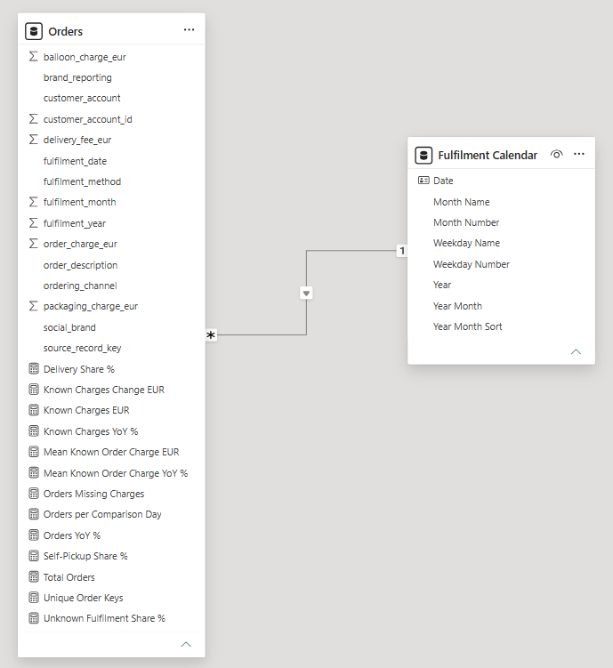

# Small Business Sales and Order Analytics

Technical documentation supporting a completed Excel / Power Query, MySQL and
Power BI reporting project using real operational data.

[Read the case study](https://alex-karam.github.io/projects/small-business-sales-and-order-analytics/index.html)
| [View the four-page report](https://alex-karam.github.io/projects/small-business-sales-and-order-analytics/small-business-sales-and-order-analytics-report.pdf)

## Verification

Both SQL examples were executed in MySQL Workbench. The Business overview
query matched the Power BI counts, missing charges, charge sums and means for
January–October 2025 and 2026. The remote fulfilment query matched all four
published cards for January–October 2026. The DAX control query also reproduced
the published year-over-year comparisons. See [validation](validation.md).

## Business question

How did orders, recorded order charges, ordering channels, fulfilment methods
and weekday demand compare across January-October 2025 and 2026?

The report describes fulfilment-date activity. Order charges are recorded
amounts, not profit or confirmed cash receipts. An order is not necessarily a
unique customer.

## Technical evidence

- [Business overview controls](sql/01_business_overview_controls.sql): a read-only
  aggregation of the same reporting view imported into Power BI.
- [Input contract](docs/reporting_view_contract.md): required fields, reporting
  grain and filter scope for both SQL queries.
- [Power BI model](docs/power-bi-model.md): actual Model view, linked date
  columns, cardinality, filter direction and reporting-layer design.
- [DAX measures](dax/measures.md): all 13 actual definitions, their filter
  context and the distinction between measure logic and report-page filters.
- [DAX control query](dax/validate_business_overview.dax): an explicit
  January-October check of the existing measures, verified in Power BI.
- [Remote fulfilment controls](sql/02_remote_fulfilment_controls.sql): the
  verified SQL check of the remote-order count and method shares.
- [Power Query column alignment](power-query/README.md): the implemented
  function that aligns two worksheet layouts and preserves source row numbers.
- [Validation](validation.md): verified SQL/Power BI controls and the current
  verification status.

Power BI Model view

## From SQL to a report card

The Business overview query counts included orders in each January–October
period. Power BI imports the same view and uses the fulfilment calendar to
filter `[Total Orders]`. The `[Orders YoY %]` measure evaluates the prior year
with the same month numbers. SQL and Power BI both returned 3,218 orders for
2025 and 3,005 for 2026. These are the counts behind the published 2026 card
and its −6.62% year-over-year change.

## Data access and reproducibility

The owner approved the report's aggregate results for publication. The business
identity, source records, private database and imported-data Power BI file
remain private. The SQL examples require a compatible `v_orders` view in the
selected MySQL database. The DAX control query requires the documented model
and measures. The displayed controls are real aggregate results.

## Method

1. Standardise monthly operational worksheets with Excel / Power Query while
   preserving source references and original values.
2. Review classifications and corrections, model the records in MySQL and
   expose a reporting view with one row per included order.
3. Import that view into Power BI, relate fulfilment dates to a calendar and
   define explicit DAX measures.
4. Reconcile counts and charges, test filters and review the exported report.

## Scope

This technical companion documents selected implemented work. It does not
claim to publish the complete private cleaning history or reproduce the source
database from scratch. Product ranking, profitability and forecasting are
outside the four-page report; some customer-identity questions remain unresolved.
