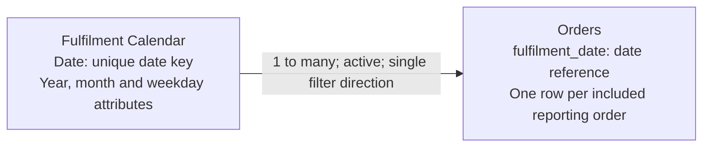
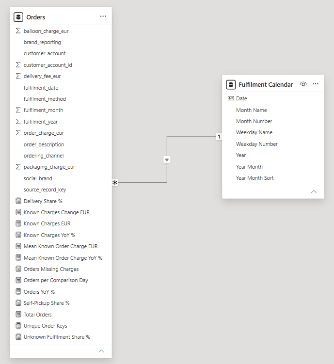

# Power BI reporting model

## Implemented relationship

The model and relationship settings were checked in Power BI Desktop on
9 November 2026. The reporting model connects a fulfilment-date calendar to
the imported orders view.

| Property | Verified setting |
| --- | --- |
| One-side column | `Fulfilment Calendar[Date]` |
| Many-side column | `Orders[fulfilment_date]` |
| Cardinality | One calendar date to many orders; the dialog shows Many to one (*:1) when opened from Orders |
| Relationship active | Yes |
| Cross-filter direction | Single: Fulfilment Calendar filters Orders |

The arrow describes filter propagation. The equality used by the relationship
is `Fulfilment Calendar[Date] = Orders[fulfilment_date]`.

## Actual Model view

This is the existing report's Model view, with field and measure names visible.
It contains no customer-level values or connection details.

## Why this model is used

- `Orders` is imported from the MySQL `v_orders` reporting view. The view already
  exposes the reporting classifications and reviewed charges; the SQL-layer
  lookup tables are not separately imported into this reporting model.
- Each included reporting order has its own source key. Multiple orders may
  share the same fulfilment date, which belongs on the many side.
- Calendar attributes supply month selection, year comparisons and weekday
  grouping on a consistent fulfilment-date basis.
- The active relationship allows calendar selections to filter order rows.
  DAX measures can further modify their calculation context; their exact
  implementations are available in the [measure catalogue](../dax/measures.md).
- The main report compares January-October in both years. This reporting scope
  is distinct from the relationship itself and from closure-date exclusions in
  the separate orders-per-comparison-day measure.

The model diagram documents the Power BI reporting layer. It is not a diagram
of the complete private MySQL cleaning, lookup and source-history schema.
